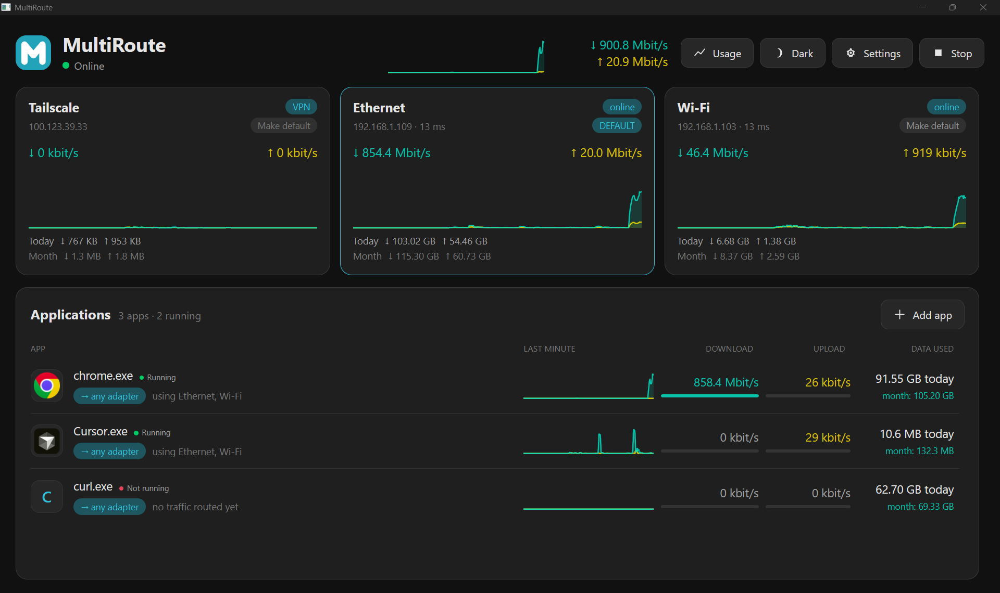
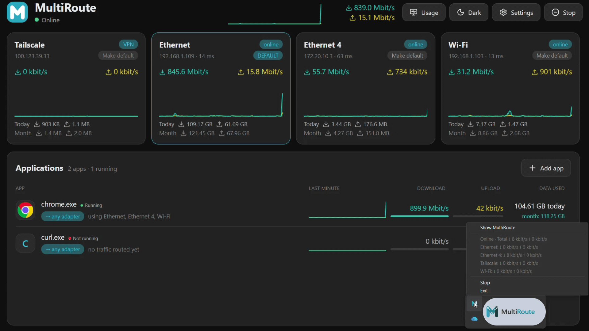
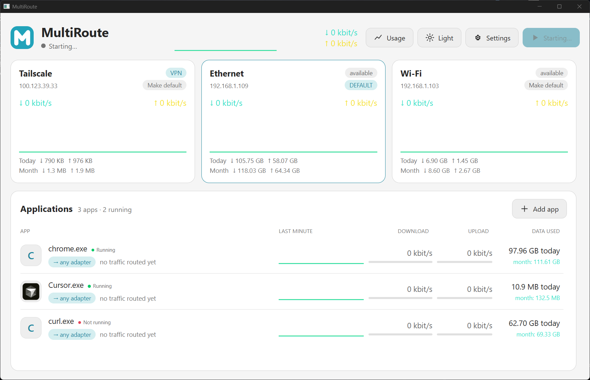
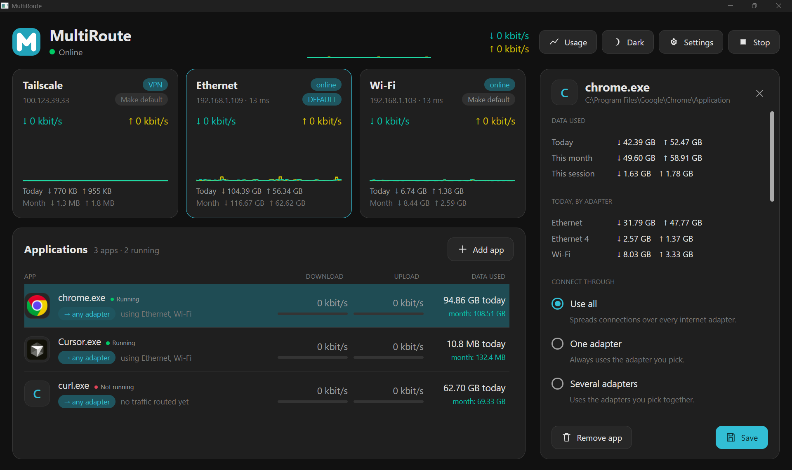
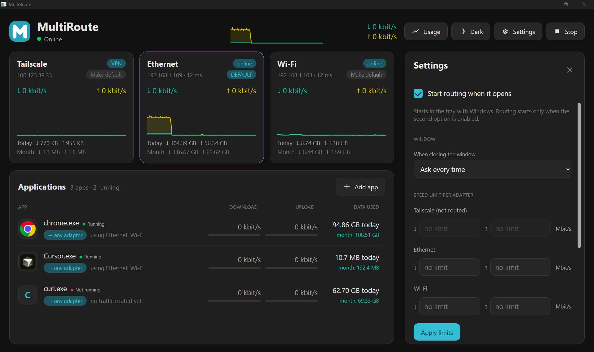
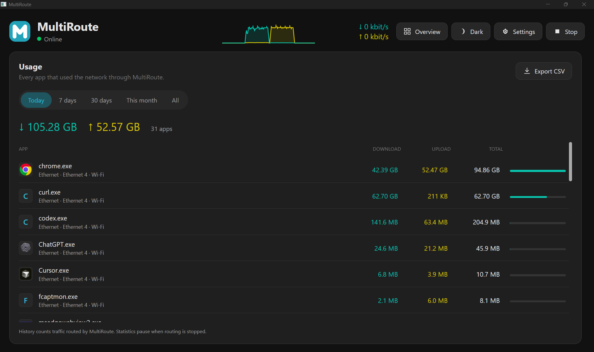
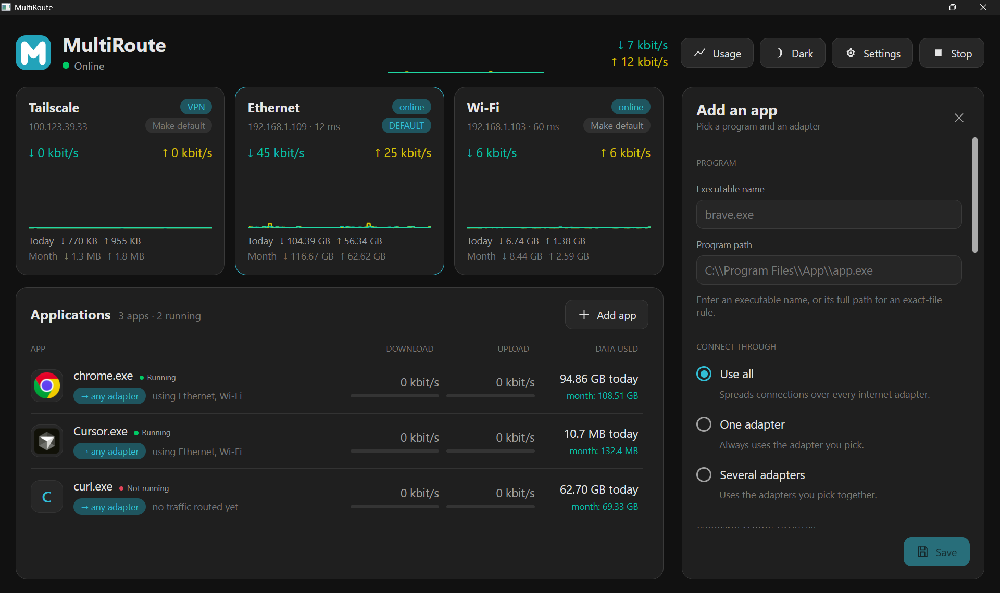

<div align="center">


# MultiRoute · MultiRouteNetwork

<em>Route applications across your network adapters. Monitor traffic, set limits, and keep control from one desktop.</em>

<br />

<a href="https://github.com/aristache-labs/MultiRouteNetwork/releases/latest">Download for Windows</a>

<br /><br />



<br />


<strong>Windows desktop &middot; experimental Ubuntu and macOS packages &middot; per-app routing &middot; local usage history</strong><br>
<sub>Source version <b>0.5.0</b>. The GUI is MultiRoute; the routing engine is MultiRouteNetwork. Windows is the supported desktop. Ubuntu 24.04 x64 and macOS 14+ packages are an experimental prerelease: native tray, window and authorization checks are still outstanding.</sub>

<br />

[Stack](#stack) &middot; [The app](#the-app) &middot; [Local setup](#local-setup) &middot; [Settings and app rules](#settings-and-app-rules) &middot; [Deployment](#deployment)

<sub><b>Developers / AI agents:</b> architecture and platform details live in <a href="docs/DEVELOPING.md">DEVELOPING.md</a>; routing, limits and diagnostics are explained in the <a href="docs/USER-GUIDE.md">user and technical guide</a>.</sub>

<br /><br />



<br />
</div>

---

## Overview

MultiRoute is a Windows desktop for routing applications over Ethernet, Wi-Fi and other eligible internet adapters. Choose which connections each app may use, monitor download/upload rates, apply speed limits or data caps, and review usage stored on your own PC.

**One connection stays on one adapter.** Applications with multiple connections can use several adapters at once; a single TCP transfer is not split across links. Ethernet and Wi-Fi on the same router still share that router's internet capacity.

The project builds on the MIT-licensed net-merge engine. The supported desktop package is **Windows x64**. Experimental packages also cover **Ubuntu 24.04 x64** and **macOS 14 or newer** on Apple Silicon and Intel. Those packages are not a completed native verification.

## Table of Contents

- [Overview](#overview)
- [Stack](#stack)
- [The app](#the-app)
- [Architecture overview](#architecture-overview)
- [Prerequisites](#prerequisites)
- [Local setup](#local-setup)
  - [1. Download and run](#1-download-and-run)
  - [2. Clone and install](#2-clone-and-install)
  - [3. Build the desktop package](#3-build-the-desktop-package)
  - [4. Verify locally](#4-verify-locally)
- [Commands](#commands)
- [Settings and app rules](#settings-and-app-rules)
- [Deployment](#deployment)
- [Contributing](#contributing)
- [Contributors](#contributors)
- [License](#license)
- [Support the project](#support-the-project)
- [Connect](#connect)

---

## Stack

| Layer | Technology |
| --- | --- |
| Desktop framework | Wails v3 |
| Frontend | React 19, TypeScript, Vite, CSS |
| Native webview | Microsoft WebView2 on Windows; GTK 4 and WebKitGTK on Ubuntu; WKWebView on macOS |
| Routing engine | Go, tun2socks and gVisor netstack |
| Network device | Wintun on Windows; TUN on Linux; utun on macOS |
| GUI / engine transport | Per-user Windows named pipe; Unix socket to a root service on Linux and macOS |
| Local storage | SQLite through modernc.org/sqlite |
| Icons | Inline SVG controls and generated native MultiRoute icons |
| Frontend package manager | npm |
| Tests | Go tests, race detector, Node tests and offline Playwright checks |
| Distribution | A version tag builds a Windows ZIP, an Ubuntu amd64 `.deb`, and signed macOS `.dmg` files. A prerelease does not replace Latest |

---

## The app

1. **Overview** — adapter cards, connection state, download/upload graphs and daily/monthly totals.
2. **Applications** — add executable-name or exact-path rules; running apps stay above stopped apps, with stable traffic ordering.
3. **Routing** — use all eligible adapters, one adapter or a selected subset, with configurable fallback.
4. **Limits** — independent download/upload limits, per-adapter limits and daily/monthly data caps.
5. **Usage** — local traffic history for Today, 7 days, 30 days, This month or All, with CSV export.
6. **Appearance** — dark/light themes, responsive panels and inline download/upload icons.
7. **System tray** — show the window, inspect total/adapter rates, Start/Stop routing or Exit. Tooltip statistics refresh once per second.

Screenshots document the supplied captures; some show controls from before the latest icon refresh. The GIF demonstrates traffic activity rather than a guaranteed throughput result.

<table>
<tr><td width="50%"><b>Light theme</b><br></td><td width="50%"><b>Application routing</b><br></td></tr>
<tr><td><b>Settings</b><br></td><td><b>Usage history</b><br></td></tr>
<tr><td colspan="2"><b>Add an application</b><br></td></tr>
</table>

---

## Architecture overview

- **Desktop** — `desktop/` hosts Wails, the local API, native window lifecycle and tray. React/TypeScript source is in `desktop/frontend/src/`.
- **Engine** — `cmd/MultiRouteNetwork/` launches the separate routing process. The GUI runs without elevation and requests elevation for the engine as needed.
- **Control** — `internal/control/` owns saved rules, settings, limits, usage accounting and the per-user pipe `\\.\pipe\MultiRoute-<SID>`.
- **Balancing** — new connections use weighted busy-flow scheduling for all/several adapters. Fastest mode deliberately chooses one adapter, with an eight-second hold. Existing connections retain their adapter.
- **Storage** — `%LOCALAPPDATA%\MultiRouteNetwork\multiroute.db` stores rules, settings and usage. Window-close preferences are stored alongside it.
- **Graphs** — traffic sampling and displayed numeric rates update every 70 ms. Graphs retain approximately 60 seconds and use one-second visual smoothing. Presentation does not change measured byte totals or traffic limits.
- **Local data** — no account or analytics service is added. Usage covers traffic observed through the routing engine, not all historical Windows traffic.

The [user and technical guide](docs/USER-GUIDE.md) explains graph scales, connection pinning, data caps, DNS scope and performance evidence. [DEVELOPING.md](docs/DEVELOPING.md) covers the implementation and platform details.

---

## Prerequisites

For the Windows release:

- **Windows x64** with Microsoft WebView2 installed.
- Administrator approval when starting the routing engine.
- One or more eligible network adapters. Multiple independent upstreams are needed to combine independent internet capacity.

To build from source:

- **Go** matching `go.mod` and **Node.js 22 with npm**, as used in CI.
- PowerShell on Windows for desktop packaging.
- Network access for dependencies and the verified Wintun download on the first package build.

---

## Local setup

### 1. Download and run

Download the Windows ZIP from [Releases](https://github.com/aristache-labs/MultiRouteNetwork/releases/latest), extract the complete folder, and launch **MultiRoute.exe**. Keep both executables, `wintun.dll` and the accompanying license files together. The portable package does not need an installer.

Click **Start** and approve the engine elevation prompt. Add applications with **+ Add app**, then choose their adapter policy. Unsigned builds may receive Windows trust or antivirus prompts.

**Stop** closes routed flows and removes capture routes while retaining the prepared device for faster resume. **Hide** leaves the current routing state active. **Exit** stops and closes both GUI and engine. Interrupted applications may need to reconnect.

### 2. Clone and install

```powershell
git clone https://github.com/aristache-labs/MultiRouteNetwork.git
cd MultiRouteNetwork
go mod download
npm ci --prefix desktop/frontend
```

No API keys, external database or `.env` file are required for the desktop package. Saved rules and statistics remain in the local state directory; updating the application does not require deleting it.

### 3. Build the desktop package

```powershell
.\scripts\package-desktop.ps1
```

This builds frontend assets and writes `MultiRoute.exe`, `MultiRouteNetwork.exe`, Wintun and package notices to `dist/multiroute`. It reads `VERSION`, currently **0.5.0**, and does not launch the GUI or install over an existing copy.

### 4. Verify locally

Build the embedded frontend before Go checks on a fresh checkout:

```powershell
npm run build --prefix desktop/frontend
go vet ./...
go test ./...
go test -race ./desktop ./internal/control ./internal/rules ./internal/engine
node --experimental-strip-types --test desktop/frontend/tests/speed-scale.test.ts desktop/frontend/tests/traffic-order.test.ts desktop/frontend/tests/graph-smoothing.test.ts
```

Offline layout and graph checks require Playwright installed separately. They use mocked APIs, do not open the native GUI, and do not run real network transfers:

```powershell
$env:PLAYWRIGHT_MODULE = 'C:/path/to/node_modules/playwright'
node desktop/frontend/tests/responsive-layout.cjs
node desktop/frontend/tests/header-rate-layout.cjs
node desktop/frontend/tests/spark-motion.cjs
node desktop/frontend/tests/spark-startup.cjs
```

---

## Commands

| Command | Purpose |
| --- | --- |
| `npm ci --prefix desktop/frontend` | Install locked frontend dependencies |
| `npm run build --prefix desktop/frontend` | Type-check and build embedded frontend assets |
| `go vet ./...` | Check Go packages after frontend build |
| `go test ./...` | Run Go tests without launching the GUI |
| `.\scripts\package-desktop.ps1` | Build the Windows desktop package |
| `MultiRouteNetwork.exe version` | Show the engine build version |
| `MultiRouteNetwork.exe status` | Inspect the running engine |
| `MultiRouteNetwork.exe run -hidden` | Run the headless engine used by the desktop |
| `MultiRouteNetwork.exe cleanup` | Remove leftover capture routes after a failure |

Legacy tray, SOCKS5 and other engine commands are documented in the [guide](docs/USER-GUIDE.md#engine-commands). The legacy installer script recreates `dist`; use `package-desktop.ps1` for the Wails application.

---

## Settings and app rules

- **Program matching** — choose an executable name, such as `chrome.exe`, or its full executable path. Exact-path rules take priority.
- **Connect through** — all eligible adapters, one adapter, or several selected adapters. Fallback can wait, use other adapters, use the default or use selected backups.
- **Speed limits** — app-wide limits constrain combined app traffic. A 10 Mbit/s limit on each of three adapters can allow approximately 30 Mbit/s together; adapter limits are not one shared global cap.
- **Data caps** — daily/monthly download-plus-upload allowance, with an 80% warning. Removing a cap clears its block; increasing it rechecks usage without restarting the engine. Closed connections must reconnect.
- **DNS** — Windows default, Cloudflare, Google, Quad9 or custom plain DNS. Only routed TCP/UDP port 53 traffic is covered; encrypted DNS and application-owned resolvers can bypass that scope.
- **Startup** — Start with Windows and Start routing when it opens are separate options.
- **Closing the window** — ask each time, hide to tray, or exit; the prompt can remember your choice.
- **Updates** — automatic installation remains disabled; the Settings controls are placeholders.

Rules can be edited while routing is stopped. Routing changes affect new connections; existing connections do not migrate to another adapter.

---

## Deployment

Desktop packages are built by [GitHub Actions](https://github.com/aristache-labs/MultiRouteNetwork/actions/workflows/release.yml) from a tag such as **`v0.5.0`**.

1. Synchronize `VERSION`, engine and desktop fallbacks, frontend package/lock versions and `CHANGELOG.md`.
2. Build and test locally, commit the intended source and push the commit. Do not start the GUI from the packaging scripts.
3. Push the matching `vX.Y.Z` tag. The workflow validates versions and builds Windows, Ubuntu and macOS packages.
4. Every published executable must identify the tagged commit with `vcs.modified=false`.
5. While [packaging/release-channel](packaging/release-channel) says `prerelease`, the tag is published as a prerelease and does not replace the Latest Windows release. The stable alias job runs only after that file says `stable`.

The Windows asset is a portable x64 ZIP. The Ubuntu asset is an amd64 `.deb` for 24.04 with a systemd service. The macOS assets are separate signed and notarized disk images for Apple Silicon and Intel, installed to `/Applications`. macOS signing uses the `desktop-signing` GitHub Environment (`APPLE_CERTIFICATE_BASE64`, `APPLE_CERTIFICATE_PASSWORD`, `APPLE_NOTARY_ISSUER_ID`, `APPLE_NOTARY_KEY_ID`, `APPLE_NOTARY_KEY_BASE64`). If those secrets are missing, the Mac jobs fail and nothing is published.

The Ubuntu and macOS packages are experimental. Tray appearance, the window and the administrator prompt still need a check on those systems. Fedora, Linux ARM64, Homebrew and apt/dnf repositories are not in this version. Automatic in-app updating is not enabled. Versions 0.4.0–0.4.5 remain retrospective source milestones, not invented historical releases.

---

## Contributing

Fork, branch and open a pull request. See [CONTRIBUTING.md](CONTRIBUTING.md) for project checks and [Issues](https://github.com/aristache-labs/MultiRouteNetwork/issues) for bugs or ideas. Report vulnerabilities following [SECURITY.md](SECURITY.md).

Include the application/engine version and reproduction steps. Preserve existing rules and usage data, and distinguish mocked/browser verification from native desktop testing.

## Contributors

Thanks to everyone contributing to MultiRouteNetwork and its upstream foundations.

<a href="https://github.com/aristache-labs/MultiRouteNetwork/graphs/contributors">
  
</a>

## License

Licensed under **MIT**. See [LICENSE](LICENSE). The project retains the upstream net-merge copyright and notices. Wintun and other dependencies have their own terms; see [THIRD-PARTY-NOTICES.md](THIRD-PARTY-NOTICES.md) and keep the supplied license files with redistributed binaries.

## Support the project

MultiRouteNetwork is free and open source. If it helps your workflow, you can [support development on Buy Me a Coffee](https://buymeacoffee.com/aristache), report issues or contribute improvements.

## Connect

<div align="center">

**Adrian Cristache** · [aristache.dev](https://www.aristache.dev)

<a href="https://github.com/aristache-labs"></a>
<a href="https://www.aristache.dev"></a>

</div>
