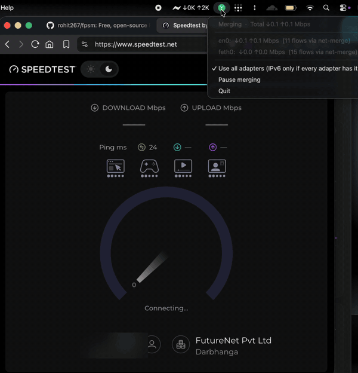
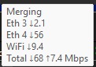
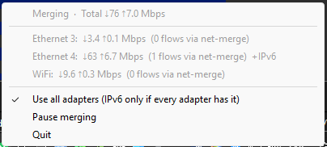
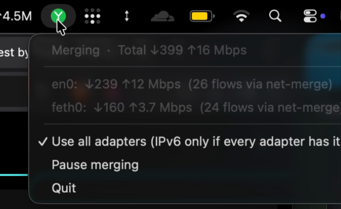
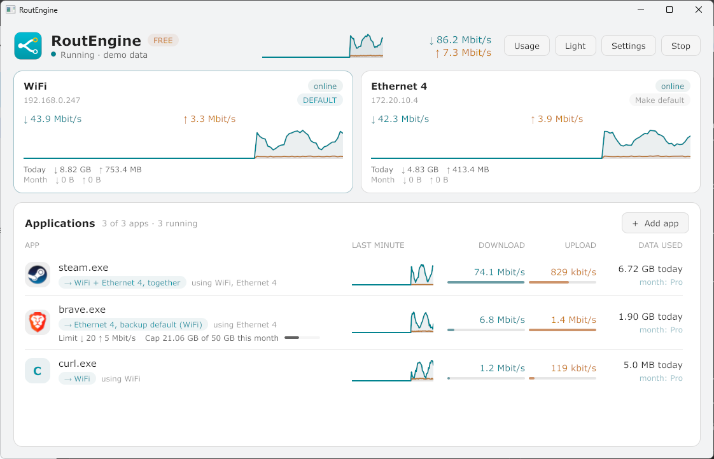

<p align="center">
  
</p>

<h1 align="center">MultiRouteNetwork</h1>

<p align="center">
  <strong>Use all your internet connections at the same time.</strong><br>
  Combine Wi-Fi, Ethernet and phone hotspots, so downloads, games and browsers get the speed of every connection added up.
</p>

<p align="center">
  <a href="https://github.com/aristache-labs/MultiRouteNetwork">Repository</a> ·
  <a href="https://github.com/aristache-labs/MultiRouteNetwork/releases/latest">Download</a> ·
  <a href="#android">Android</a> ·
  <a href="#install">Install</a> ·
  <a href="#add-a-second-connection">Add a second connection</a> ·
  <a href="#troubleshooting">Troubleshooting</a> ·
  <a href="docs/DEVELOPING.md">How it works</a>
</p>

<p align="center">
  <a href="https://github.com/aristache-labs/MultiRouteNetwork/actions/workflows/ci.yml"></a>
  <a href="https://github.com/aristache-labs/MultiRouteNetwork/releases"></a>
  <a href="https://github.com/aristache-labs/MultiRouteNetwork/releases"></a>
  <a href="LICENSE"></a>
  
  <a href="https://buymeacoffee.com/aristache"></a>
</p>

<p align="center">
  <a href="https://trendshift.io/repositories/301802?utm_source=trendshift-badge&amp;utm_medium=badge&amp;utm_campaign=badge-trendshift-301802" target="_blank" rel="noopener noreferrer"></a>
  <a href="https://trendshift.io/repositories/301802?utm_source=trendshift-badge&amp;utm_medium=badge&amp;utm_campaign=badge-trendshift-301802" target="_blank" rel="noopener noreferrer"></a>
</p>

<p align="center">
  
  <br>
  <sub>A Mac with Wi-Fi + an Android phone. The menu shows both connections working at once. <a href="docs/demo.mp4">Watch the full 45-second video.</a></sub>
</p>

MultiRouteNetwork uses all your network adapters together. It works on **Windows, macOS and Linux**. It is free.
There is no account, no server and no VPN.

A real test with Wi-Fi + an Android USB tether + an iPhone hotspot, 9 downloads at once:
**232-303 Mbit/s**. The fastest connection alone gave about 121 Mbit/s.

| Windows: hover the icon | Windows: the menu | macOS: the menu bar |
|---|---|---|
|  |  |  |

## How it helps

MultiRouteNetwork gives every new connection to one of your links. When an app opens many connections, they
spread over all your links.

- **Good for:** Steam and game downloads, browsers, system updates, cloud uploads (Google Drive),
  download managers like IDM, torrents.
- **Not for:** one single connection. One connection always uses one link, so one big file from one
  connection does not get faster. Browsers can split a download into several connections; see the tip
  under [Use it](#use-it).
- **Works for every app**, TCP and UDP, IPv4 and IPv6. You do not set up a proxy.
- **Smart:** faster links get more connections. A link with no internet gets none until it works again.
- **Safe:** if MultiRouteNetwork crashes, your internet keeps working.
- **Light:** about 0.18 CPU cores per 100 Mbit/s.

## Install

**macOS and Linux**: paste this into a terminal.

```
curl -fsSL https://raw.githubusercontent.com/aristache-labs/MultiRouteNetwork/main/install.sh | sh
```

**Windows**: paste this into PowerShell.

```
irm https://raw.githubusercontent.com/aristache-labs/MultiRouteNetwork/main/install.ps1 | iex
```

Antivirus blocked it? Download [MultiRouteNetwork-setup.exe](https://github.com/aristache-labs/MultiRouteNetwork/releases/latest/download/MultiRouteNetwork-setup.exe)
and double-click it instead.

That's it: MultiRouteNetwork is installed and its icon appears in the menu bar or tray. On Linux the script
uses your package manager (apt, dnf, zypper, apk or pacman) and on macOS Homebrew when you have it, so
MultiRouteNetwork updates with the rest of your system. To start it at sign-in, tick *Start at sign-in* in its menu.

**Android**: see [Android](#android) below.

> **Want to choose the connection for each app?** [RoutEngine](https://routengine.net/?utm_source=MultiRouteNetwork&utm_medium=readme-callout) is the
> upgraded commercial version of MultiRouteNetwork, for Windows, macOS and Linux. Pick an adapter per app, add a fallback, and set a speed
> limit or data cap per app. Free for personal use, Pro for work.

<details>
<summary><strong>Rather type the commands yourself?</strong> One block per system, each ready to paste.</summary>
<br>

**macOS without Homebrew**:

```
curl -fsSL https://github.com/aristache-labs/MultiRouteNetwork/releases/latest/download/MultiRouteNetwork-macos-universal.tar.gz | tar -xz -C /tmp MultiRouteNetwork && sudo /tmp/MultiRouteNetwork install && MultiRouteNetwork tray
```

**Linux package repositories / Homebrew**: a package host and tap have not been
configured for this fork. Use source builds or assets actually available on our
[releases page](https://github.com/aristache-labs/MultiRouteNetwork/releases).
The build scripts retain packaging support but require an explicitly configured host.

**Any other Linux** (any CPU):

```
curl -fsSL https://github.com/aristache-labs/MultiRouteNetwork/releases/latest/download/MultiRouteNetwork-linux-$(uname -m).tar.gz | tar -xz -C /tmp MultiRouteNetwork && sudo install -m 755 /tmp/MultiRouteNetwork /usr/local/bin/ && sudo setcap cap_net_admin,cap_net_raw+ep /usr/local/bin/MultiRouteNetwork
```

**Windows by hand**: download [MultiRouteNetwork-setup.exe](https://github.com/aristache-labs/MultiRouteNetwork/releases/latest/download/MultiRouteNetwork-setup.exe)
and run it. Windows may warn because the app is not signed yet: click *More info*, then *Run anyway*.
There is also a [portable zip](https://github.com/aristache-labs/MultiRouteNetwork/releases/latest/download/MultiRouteNetwork-portable.zip).

Then start it with `MultiRouteNetwork tray` (Linux, macOS) or from the Start menu (Windows).
</details>

<details>
<summary><strong>Good to know</strong></summary>
<br>

- **Which CPUs:** x86-64, ARM64 and Apple Silicon, ARMv7, ARMv6 (Raspberry Pi), x86 32-bit, RISC-V,
  PowerPC (ppc64le), s390x and LoongArch.
- **No password prompts:** the Linux packages give MultiRouteNetwork the network rights it needs (`setcap`), and on
  macOS `MultiRouteNetwork install` adds one rule so that only `MultiRouteNetwork tray` can run as root without a password.
- **Linux tray icon:** needs a desktop with StatusNotifierItem support: KDE, XFCE, Cinnamon, LXQt, Budgie,
  or GNOME with the *AppIndicator and KStatusNotifierItem Support* extension (Ubuntu already has it).
- **Firewall:** if it blocks unknown traffic, trust the `MultiRouteNetwork` interface
  (for example `firewall-cmd --zone=trusted --add-interface=MultiRouteNetwork`).
- **Signed repositories:** apt, dnf, zypper and pacman use the key in
  [`packaging/apt-signing-key.asc`](packaging/apt-signing-key.asc), fingerprint
  `0168 C7AB 7772 1656 9048 11AE 904F 61E7 F4F1 C2A1`.
</details>

## Android

MultiRouteNetwork for Android uses Wi-Fi and mobile data at the same time. No root, no account, no server. It is
new (beta).

1. On your phone, download
   [MultiRouteNetwork-android.apk](https://github.com/aristache-labs/MultiRouteNetwork/releases/latest/download/MultiRouteNetwork-android.apk).
2. Open it and install it. If Android asks, allow your browser or file manager to install apps.
3. Open **MultiRouteNetwork**, tap the power button and tap **OK** on the VPN prompt.
4. Optional: add the **MultiRouteNetwork** tile to Quick Settings to turn it on and off with one tap.

It needs Android 8.0 or newer.

- **Faster:** apps that open many connections at once, like web pages, torrents, cloud backups and download
  managers (ADM with several parts).

**Limitations**

- **One connection stays on one network.** A Play Store download, a single browser download and one video
  mostly use one connection, so they don't get faster. We measured a 1 GB Play Store download: all of it went
  over one connection. Splitting one connection over two networks needs a server in the middle, and MultiRouteNetwork
  doesn't use one.
- **Mobile data stays on** while MultiRouteNetwork runs, so keep an eye on your data plan.
- **One VPN at a time:** Android lets only one VPN app run, so MultiRouteNetwork can't run next to another VPN.
- **Problems?** [Open an issue](https://github.com/aristache-labs/MultiRouteNetwork/issues/new/choose) and pick *Android*.
  The code is in [MultiRouteNetwork/android](https://github.com/aristache-labs/MultiRouteNetwork).

## Uninstall

**macOS and Linux**: paste this into a terminal. It stops MultiRouteNetwork and removes it the way it was
installed (Homebrew, apt, dnf, zypper, apk, pacman or the download), with its repository and key.

```
curl -fsSL https://raw.githubusercontent.com/aristache-labs/MultiRouteNetwork/main/install.sh | sh -s -- uninstall
```

**Windows**: paste this into PowerShell, or use *Settings > Apps > Installed apps > MultiRouteNetwork > Uninstall*.

```
& "$env:ProgramFiles\MultiRouteNetwork\MultiRouteNetwork.exe" quit; Start-Process "$env:ProgramFiles\MultiRouteNetwork\unins000.exe" '/SILENT' -Verb RunAs -Wait
```

Your network goes back to normal as soon as MultiRouteNetwork stops: it removes its virtual adapter and routes
when it quits, and even after a crash.

<details>
<summary><strong>Rather type the commands yourself?</strong> One block per way you installed it.</summary>
<br>

Each block first stops the tray and turns off start at sign-in, then removes MultiRouteNetwork.

**Homebrew** (macOS):

```
MultiRouteNetwork quit; MultiRouteNetwork autostart off; sudo MultiRouteNetwork uninstall; brew uninstall MultiRouteNetwork
```

**macOS without Homebrew**:

```
MultiRouteNetwork quit; MultiRouteNetwork autostart off; sudo MultiRouteNetwork uninstall
```

**Debian, Ubuntu, Linux Mint, Pop!_OS, Raspberry Pi OS** (apt):

```
MultiRouteNetwork quit; MultiRouteNetwork autostart off; sudo apt remove -y MultiRouteNetwork && sudo rm -f /etc/apt/sources.list.d/MultiRouteNetwork.list /usr/share/keyrings/MultiRouteNetwork.gpg
```

**Fedora, RHEL, Rocky, Alma** (dnf):

```
MultiRouteNetwork quit; MultiRouteNetwork autostart off; sudo dnf remove -y MultiRouteNetwork && sudo rm -f /etc/yum.repos.d/MultiRouteNetwork.repo
```

**openSUSE** (zypper):

```
MultiRouteNetwork quit; MultiRouteNetwork autostart off; sudo zypper remove -y MultiRouteNetwork && sudo zypper removerepo MultiRouteNetwork
```

**Arch, Manjaro, EndeavourOS** (pacman):

```
MultiRouteNetwork quit; MultiRouteNetwork autostart off; sudo pacman -R --noconfirm MultiRouteNetwork && sudo sed -i '/^\[MultiRouteNetwork\]$/,/^Server = .*MultiRouteNetwork/d' /etc/pacman.conf && sudo pacman-key --delete 0168C7AB77721656904811AE904F61E7F4F1C2A1
```

**Alpine** (apk):

```
MultiRouteNetwork quit; MultiRouteNetwork autostart off; sudo apk del MultiRouteNetwork && sudo sed -i -e '\#github.com/aristache-labs/MultiRouteNetwork/apk#d' /etc/apk/repositories && sudo rm -f /etc/apk/keys/MultiRouteNetwork.rsa.pub
```

**Homebrew** (Linux):

```
MultiRouteNetwork quit; MultiRouteNetwork autostart off; brew uninstall MultiRouteNetwork
```

**Any other Linux** (the download):

```
MultiRouteNetwork quit; MultiRouteNetwork autostart off; sudo rm -f /usr/local/bin/MultiRouteNetwork
```

**Windows portable zip**: run `MultiRouteNetwork.exe autostart off` in its folder, quit the tray, then delete the folder.

**NixOS**: remove `programs.MultiRouteNetwork` (and the `MultiRouteNetwork` input) from your configuration and rebuild.
</details>

### NixOS

```nix
# flake.nix
inputs.MultiRouteNetwork.url = "github:aristache-labs/MultiRouteNetwork";

# configuration.nix (with `inputs` passed via specialArgs)
imports = [ inputs.MultiRouteNetwork.nixosModules.default ];
programs.MultiRouteNetwork = {
  enable = true;
  autostart = true;   # optional: start the tray in every graphical session
};
```

To try it without installing: `sudo nix run github:aristache-labs/MultiRouteNetwork -- run`.

## Add a second connection

MultiRouteNetwork needs **two or more** real connections. Use Wi-Fi plus one of these: a phone (USB tethering or
hotspot), an Ethernet cable, or a second Wi-Fi. Plug it in and MultiRouteNetwork adds it within a few seconds.
When you unplug it, its connections move to the others.

**Windows and Linux:** plug the phone in and turn on *USB tethering* (Android) or *Personal Hotspot*
(iPhone). That is all.

**Mac with an iPhone** (nothing extra to install)
1. Plug the iPhone in with a cable. Tap *Trust* on the iPhone if it asks.
2. On the iPhone, open *Settings > Personal Hotspot* and turn on *Allow Others to Join*.
3. An **iPhone USB** network appears on the Mac. MultiRouteNetwork adds it in a few seconds.

**Mac with an Android phone** (needs the app **TetherKit**)

macOS cannot use Android USB tethering by itself. The app **TetherKit** adds that support.
1. Install and open TetherKit.
2. Plug the phone in and turn on *USB tethering* in the phone's settings.
3. Click **Apply** in TetherKit. MultiRouteNetwork adds the new network in a few seconds.

> **Start MultiRouteNetwork first, then connect the Android phone.** macOS drops the TetherKit connection each
> time MultiRouteNetwork starts or quits. Pausing and resuming is safe: MultiRouteNetwork keeps its virtual adapter while
> paused. If the phone link disappears, click **Apply** in TetherKit again. The iPhone is not affected.

A phone uses its mobile data, so part of your traffic goes through it while MultiRouteNetwork runs. Quit
MultiRouteNetwork when you do not want that.

## Use it

1. Start MultiRouteNetwork. A tray icon appears (menu bar on Mac).
2. The icon is **green** when it is merging and **grey** when it is paused.
3. **It pauses by itself** when fewer than two connections have internet, because there is nothing to
   merge, and the menu says *Paused: one connection*. It **starts again by itself** when a second
   connection works. If you pause or start it yourself, that choice wins: it will not start again after
   you paused it. Untick *Pause when there is only one connection* in the menu to switch this off, or run
   `MultiRouteNetwork tray -auto-pause=false`.
4. **Hover** the icon to see the speed of each connection and the total.
5. **Right-click** the icon (on Mac, click it) to open the menu. It shows each connection's speed, how
   many connections MultiRouteNetwork gave it, and the buttons *Pause merging* / *Start merging* and *Quit*. The
   line above *Quit* is the version you are running, like `v0.3.3`. It reads the newest release number
   from GitHub (at start, and again every 6 hours) and turns into *Update to v0.3.4* if there is one;
   click it to open the release page. Click a connection to cap it at 1, 2, 5, 10, 20, 50 or 100 Mbit/s
   (or *Unlimited*). For any other speed, from a terminal: `MultiRouteNetwork limit "Ethernet 2" 25` (Mbit/s; 0 or
   `unlimited` removes the cap), and `MultiRouteNetwork limit` lists what is set. The cap covers its downloads and
   uploads and is remembered after a restart. Only traffic MultiRouteNetwork relays is capped: an app bound directly
   to an adapter (for example qBittorrent on a fixed interface) ignores it.
6. To start it at sign-in: tick *Start at sign-in* in the menu (or the box in the Windows installer, or run
   `MultiRouteNetwork autostart on`). On a Mac this needs `sudo MultiRouteNetwork install` once.

Tips:
- Torrent clients already use every connection. Leave qBittorrent's network interface on *Any interface*.
- **Faster browser downloads.** A browser downloads a file over one connection, so it uses one link. Chrome,
  Edge, Brave and other Chromium browsers can split it over several connections instead:
  1. Open `chrome://flags/#enable-parallel-downloading` (Edge: `edge://flags/#enable-parallel-downloading`,
     Brave: `brave://flags/#enable-parallel-downloading`).
  2. Set *Parallel downloading* to *Enabled* and click *Relaunch*.

  Firefox has no such setting; for big files use a download manager, for example `aria2c -x 8 -s 8 <link>`.
  Splitting only helps when the server allows downloading parts of a file, which most large download
  sites do.
- Leave *Use all adapters (IPv6 only if every adapter has it)* ticked. Untick it only if you must reach a
  site that only has IPv6.
- `MultiRouteNetwork list` shows which connections are used and why others are skipped. `MultiRouteNetwork status`
  shows live numbers.

## Troubleshooting

<details>
<summary><strong>A second connection does not make things faster</strong></summary>
<br>

You only gain speed when each connection reaches the internet by its own path. Wi-Fi from your home
router plus a phone on mobile data works. Wi-Fi and Ethernet plugged into the **same router** do not: they
share one internet line, so the total stays the same.

Also remember that one connection always uses one link. Many parallel connections (Steam, browsers,
download managers) are what speed up. Run `MultiRouteNetwork status` to see how many connections each link carries.
</details>

<details>
<summary><strong>It does nothing while a VPN is on</strong></summary>
<br>

A VPN app on your computer (ProtonVPN, NordVPN and others) sends all your internet through itself.
MultiRouteNetwork then has nothing to share, so nothing gets faster. Using the VPN on only one link is not
safe either: anything sent over the other link skips the VPN.

Fix: set up the VPN on your routers instead, and turn the VPN app off on the computer. Most VPN
providers have a guide for routers. MultiRouteNetwork then works as normal, and all your traffic still goes
through the VPN.
</details>


<details>
<summary><strong>A connection does not show up</strong></summary>
<br>

Run `MultiRouteNetwork list`. It shows which connections are used and why the others are skipped, for example
"no default gateway" (the link has no internet yet).

- **iPhone on a Mac:** plug it in, tap *Trust*, and turn on *Settings > Personal Hotspot > Allow Others to
  Join*. If the **iPhone USB** network in *System Settings > Network* stays inactive, turn off its
  **Disable unless needed** switch.
- **Android on a Mac:** install **TetherKit** and click **Apply** (see above).
- **Phone on Windows:** if the phone does not appear in *Network Settings*, install your phone maker's USB
  driver.
</details>

<details>
<summary><strong>The Android connection disappears on a Mac</strong></summary>
<br>

macOS drops the TetherKit connection each time MultiRouteNetwork starts or quits (pausing and resuming is safe).
Start MultiRouteNetwork first, then connect the phone. If it vanishes, click **Apply** in TetherKit again.
</details>

<details>
<summary><strong>Windows uses only one network</strong></summary>
<br>

Windows can switch Wi-Fi off when Ethernet is plugged in. Open the Group Policy Editor (`gpedit.msc`),
go to *Computer Configuration > Administrative Templates > Network > Windows Connection Manager*, and set
**Minimize the number of simultaneous connections to the Internet or a Windows domain** to **Disabled**.
</details>

<details>
<summary><strong>macOS says it cannot open MultiRouteNetwork, or Windows says "protected your PC"</strong></summary>
<br>

The apps are not code-signed yet. On macOS run `xattr -d com.apple.quarantine MultiRouteNetwork`. On Windows click
*More info*, then *Run anyway*.
</details>

<details>
<summary><strong>The menu says "Paused: one connection"</strong></summary>
<br>

MultiRouteNetwork only has something to do with two or more connections that have internet, so it waits. Plug
in or connect the second one (see *Add a second connection*) and it starts by itself after a few seconds.
To merge anyway, choose *Start merging* (it then stays on until a second connection has come and gone), or
untick *Pause when there is only one connection*.

Switching merging on or off cuts the connections that are open at that moment, which is why it waits 10
seconds with nothing moving before pausing (2 minutes if a download or upload is still going) and
3 seconds before resuming,
and never switches by itself more than once every 30 seconds.
</details>

<details>
<summary><strong>I cannot find the tray icon</strong></summary>
<br>

On Windows it may be behind the `^` arrow next to the clock. On macOS it is in the menu bar. On Linux the
desktop needs StatusNotifierItem support (KDE, XFCE, Cinnamon, LXQt, Budgie, or GNOME with the *AppIndicator
and KStatusNotifierItem Support* extension).
</details>

<details>
<summary><strong>A site asks me to log in again</strong></summary>
<br>

MultiRouteNetwork may use a different IP for each connection, and some sites tie your login to one IP. That is a
limit of splitting connections over several links.
</details>

## Commands

```
MultiRouteNetwork tray            tray icon (the normal way to run it)
MultiRouteNetwork on | off        start / pause merging in the running tray
MultiRouteNetwork quit            pause and close the tray
MultiRouteNetwork status | list   live numbers / which connections are used
MultiRouteNetwork autostart on|off|status
MultiRouteNetwork socks           plain SOCKS5 proxy on 127.0.0.1:1080 (no admin, per app)
MultiRouteNetwork cleanup         remove leftover routes after a crash
MultiRouteNetwork install         macOS only: `sudo MultiRouteNetwork install` (see above)
```

More flags and details are in [docs/DEVELOPING.md](docs/DEVELOPING.md).

## Want to choose the connection for each app?

[RoutEngine](https://routengine.net/?utm_source=MultiRouteNetwork&utm_medium=readme) is the upgraded version of MultiRouteNetwork, by the same developer. Run Steam over both connections, your browser over Ethernet with Wi-Fi as a backup, and another app over Wi-Fi alone. Set a speed limit or a data cap per app. For Windows, macOS and Linux. Free for personal use, Pro for work.

<a href="https://routengine.net/?utm_source=MultiRouteNetwork&utm_medium=readme-screenshot">
  <picture>
    <source media="(prefers-color-scheme: dark)" srcset="docs/routengine-overview.png">
    
  </picture>
</a>

**[Get RoutEngine](https://routengine.net/?utm_source=MultiRouteNetwork&utm_medium=readme)**

Building a college project? [DormHost](https://dormhost.dev/?utm_source=MultiRouteNetwork&utm_medium=readme), also by the same developer, puts it online: Node.js, Python or Docker with a database, 30 days free.

## Good to know

- Needs admin (Windows), `CAP_NET_ADMIN` (Linux) or `sudo MultiRouteNetwork install` once (macOS).
- Some sites tie your login to one IP. MultiRouteNetwork may use a different IP for each connection, so such a
  site can ask you to log in again.
- If your connections differ in IPv6 support, sites that only have IPv6 are not reachable while the box
  above is ticked.

## More

- What changed in each version: [CHANGELOG.md](CHANGELOG.md)
- New versions come out once a week when something changed. Important fixes come out right away.
- How it works, building from source, tests: [docs/DEVELOPING.md](docs/DEVELOPING.md)
- Want to help? [CONTRIBUTING.md](CONTRIBUTING.md). Found a security problem? [SECURITY.md](SECURITY.md)
- License: MIT, see `LICENSE`. Third-party parts: `THIRD-PARTY-NOTICES.md`.

## Support

Report issues in [our repository](https://github.com/aristache-labs/MultiRouteNetwork/issues).

